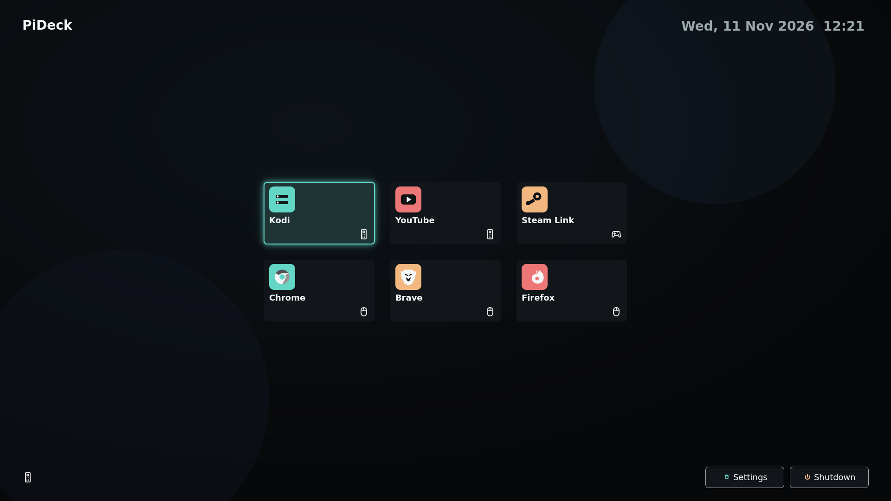
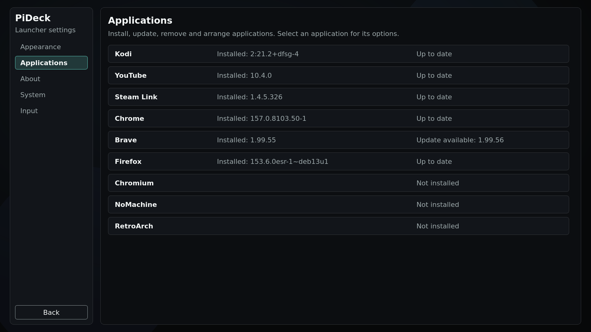
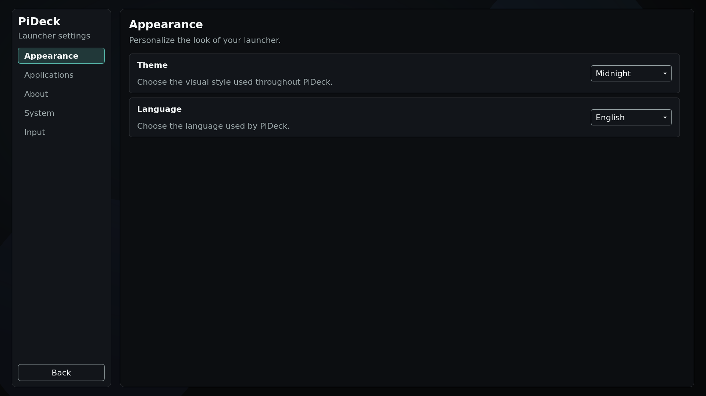
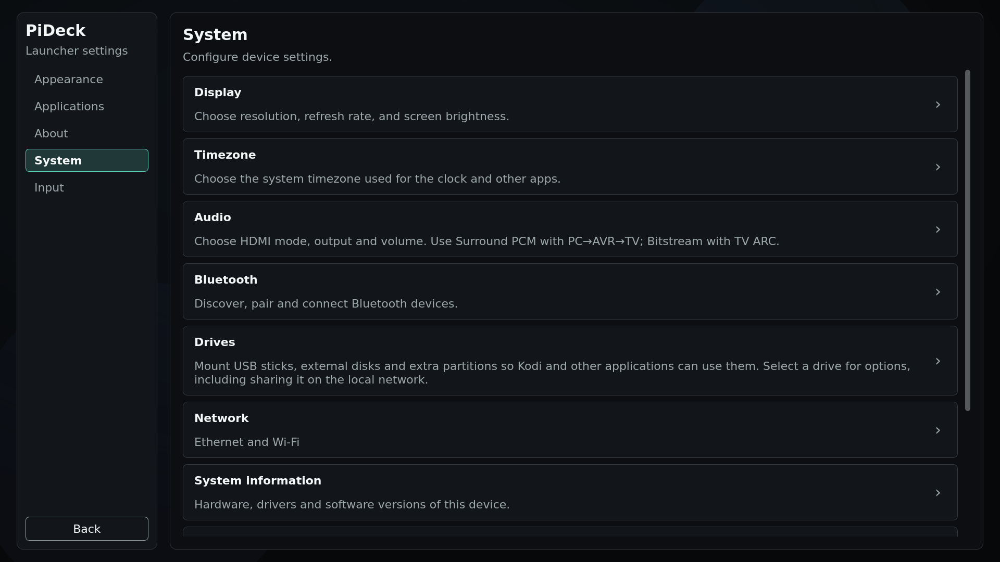

# PiDeck

PiDeck turns a Raspberry Pi 5 or an x86-64 PC into a living-room appliance:
a full-screen launcher for your TV, controlled with a remote, gamepad,
keyboard or mouse.

Images default to German for the interface and system locale. You can switch
the launcher language in Settings.

## Features

### Home screen

Apps appear as large tiles on a dark, TV-friendly home screen. Themes change
the look; the clock and input indicators stay out of the way until you need
them.

### Apps you choose

Install and update applications from Settings — including Kodi, YouTube,
Steam Link, Chrome, Brave, Firefox, Chromium, RetroArch and NoMachine.
Show only what you want on the home screen and reorder the tiles.

### Remote, gamepad and more

Use a TV remote (HDMI-CEC), a gamepad, a keyboard or a mouse. Pointers stay
hidden while you navigate with a remote or controller and come back when you
move the mouse.

### Settings for the living room

Configure appearance and language, display and audio, Bluetooth, Wi‑Fi,
USB drives (including optional LAN sharing), input and system information —
without leaving the couch.

### Back home at any time

While an app is open, the guide / home button or the remote’s exit menu opens
an overlay so you can return to PiDeck without hunting for a mouse.

### Updates on the device

PiDeck can check for and install application updates from Settings. Image and
operating-system updates are separate (see the image guides below).

## Hardware requirements

### Raspberry Pi

- Raspberry Pi 5
- HDMI display or TV (CEC-capable TV recommended for the remote)
- Storage large enough for the Pi image (see the image guide)
- Optional: gamepad, keyboard, mouse

### x86-64 PC

- 64-bit PC, BIOS or UEFI with **Secure Boot disabled**
- Disk at least **12 GiB** for the image (larger recommended for apps and media)
- HDMI (or DisplayPort) to your TV or AVR
- NVIDIA, Intel or AMD GPU (NVIDIA is the best-supported path for hardware
  video decode on the x86 image)
- Optional: **Pulse-Eight USB-CEC** adapter for the TV remote; gamepad,
  keyboard, mouse

## Install

### Raspberry Pi 5

1. Build or obtain a PiDeck Raspberry Pi image
   ([image guide](docs/raspberry-pi-image.md)).
2. Flash it with [Raspberry Pi Imager](https://www.raspberrypi.com/software/).
3. Boot the Pi connected to your TV.

### x86-64 PC

1. Build or obtain a PiDeck x86 image
   ([image guide](docs/x86-image.md)).
2. Verify the checksum, then write the image to the target disk
   (destructive — choose the disk carefully; details in the guide).
3. Boot with Secure Boot off.

Builder steps, package lists and validation checklists live in those guides —
not in this README.

## More

- [Changelog](CHANGELOG.md)
- [Raspberry Pi image](docs/raspberry-pi-image.md)
- [x86 image](docs/x86-image.md)
